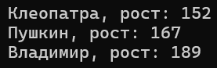
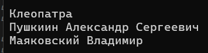
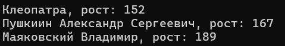
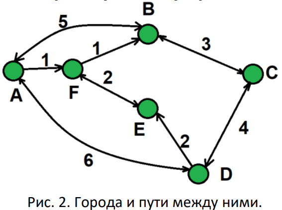
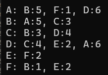
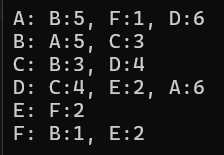

# Галловай Алёна ЛА2 Лабораторная №2

# Задание 1

## Задача 2

### Текст задачи

**Человек.**
Создайте сущность Человек, которая описывается:
* Имя: строка
* Рост: целое число
Может возвращать текстовое представление вида “Name, рост: height”, где Name и height это
переменная с именем и ростом.
Необходимо создать и вывести на экран следующих людей:
* Человек с именем “Клеопатра” и ростом 152
* Человек с именем “Пушкин ” и ростом 167
* Человек с именем “Владимир ” и ростом 189

### Алгоритм решения

Создаем класс Human с двумя приватными полями. Поле имя с строковым типом и поле роста для целых чисел. Далее описываем публичный конструктор с 2 параметрами. Получаем параметры имени и присваиваим их к свойствам. Затем создаем публичное свойство с строчным типом для имени, где данные мы можем получить, но изменить их извне не можем поэтому set приватный. И точно также для роста только там целочисленный тип. Также в свойствах есть проверка на непустую строку и на положительное число. И переопределяем метод ToString, в котором формируем и возвращаем строку для вывода, где имя и рост через запятую.

### Тестирование

## Задача 3

### Текст задачи

**Имена.**
Создайте сущность Имя, которая описывается тремя параметрами: Фамилия, Личное имя,
Отчество. Имя может быть приведено к строковому виду, включающему традиционное
представление всех трех параметров: Фамилия Имя Отчество (например “Иванов Иван
Иванович”). Необходимо предусмотреть возможность того, что какой-либо из параметров может
быть не задан, и в этом случае он не учитывается при приведении к текстовому виду.
Необходимо создать следующие имена:
* Клеопатра
* Пушкин Александр Сергеевич
* Маяковский Владимир
Обратите внимание, что при выводе на экран, не заданные параметры никак не участвуют в
образовании строки.

### Алгоритм решения

Создаем класс Имя с тремя приватными полями под ФИО. Все эти поля с строковым типом. Следом публичный конструктор с 3 параметрами (Фамилией, Именем и Отчеством). Получаем параметры ФИО и присваиваим их к свойствам. Затем описываем публичные свойства для ФИО, где можем получить данные, но изменить их нельзя. Переопределяем метод ToString, в котором проверяется на пустое поле если какое-то не задано, то оно вообще не участвует в образовании строки.

### Тестирование

# Задание 2

## Задача 2

### Текст задачи

**Человек с именем.**
Объедините сущности Человек из задачи 1.2 и Имя из задачи 1.3 таким образом, чтобы имя
человека задавалось с использованием сущности 1.3, а не строки.
Необходимо объединить ранее созданные объекты имен и людей, с получением:
* Человека с Именем Клеопатра и ростом 152
* Человека с Именем Пушкин Александр Сергеевичи ростом 167
* Человека с Именем Маяковский Владимир и ростом 189

### Алгоритм решения

Создаем класс Человека с именем с 2 приватными полями. Одно из полей будет с типом ранее созданного класса Name (из задания 1.3), а второе с типом целого числа для роста. Далее описывается конструктор с двумя параметрами. Получаем парамтры готового имени, роста и присваиваим их к свойствам. Затем создаем публичное свойство для имени с типом из класса Name, где можно получить данные, но перезаписать их нельзя. Также есть проверка объекта имени на пустоту. Создаем публичное свойство с числовым типом для роста, также данные можно получить, но изменить нельзя, есть проверка на введенное значение для роста (оно не может быть меньше или равно 0). Переопределяем метод ToString.

### Тестирование

# Задание 3

## Задача 3

### Текст задачи

**Города.**
Создайте сущность Город, которая будет представлять собой точку на карте со следующими
характеристиками:
* Название города
* Набор путей к следующим городам, где путь представляет собой сочетание Города и
стоимости поездки в него.
Кроме того, Город может возвращать текстовое представление, в виде названия города и списка
связанных с ним городов (в виде пары: “название:стоимость”).
Используя разработанную сущность реализуйте схему, представленную на рисунке 2.

### Алгоритм решения

1) Создаем класс Way с 2 приватными полями. Одно из которых с целочисленным типом данных, а второе будет с типом, который описан в классе Cities. Далее описывается публичный конструктор с 2 параметрами. Получаем параметры и присваиваим их к свойствам. Описываем публичное свойство для города с типом из класса Cities, в котором можно получить данные, но перезаписать их нельзя, также объект проверяется на пустоту. Далее публичное свойство для целочисленного поля цены в котором также можно получить данные, но изменить их извне нельзя и также есть проверка на введенную стоимость. Переопределяем метод ToString.

2) Создаем класс Cities с 3 приватными полями. Одно из полей будет с типом данных из класса Way, следующее с строковым типом данных и еще одно поле с целочисленным. Описываем публичный конструктор с 2 парметрами, в котором переданные значения присваиваются к свойствам; выделяется память под массив и обнуляется счётчик кол-ва путей из введенного города. Затем создаем публичное свойство строкового типа для имени города, в котором можно получить но не перезаписать извне данные. И свойство только для чтения данных для массива путей. Следом описывается метод который выполняет действие для записи путей в массив и проверка на заполенность. И также переопределяем метод ToString, который выводит город и массив путей если они есть.

### Тестирование

# Задание 4

## Задача 8

### Текст задачи

**Создаем Города.**
Измените сущность Город из задачи 3.3. Новые требования включают:
* Город можно создать указав только название
* Город можно создать указав название и набор связанных с ним городов и стоимостей
путей к ним

### Алгоритм решения

Алгоритм решения задачи

### Тестирование

# Задание 5

## Задача 5

### Текст задачи

**Дроби.**
Создайте сущность Дробь со следующими особенностями:
* Имеет числитель: целое число
* Имеет знаменатель: целое число
* Дробь может быть создана с указанием числителя и знаменателя
* Может вернуть строковое представление вида “числитель/знаменатель”
* Может выполнять операции сложения, вычитания, умножения и деления с другой Дробью
или целым числом. Результатом операции должна быть новая Дробь (таким образом,обе
исходные дроби не изменяются)
Затем необходимо выполнить следующие задачи:
1. Создать несколько экземпляров дробей.
2. Написать по одному примеру использования каждого метода.
3. Вывести на экран примеры и результаты их выполнения в формате «1/3 * 2/3 = 2/9»
4. Посчитать f1.sum(f2).div(f3).minus(5)

### Алгоритм решения

Алгоритм решения задачи

### Тестирование

Скриншоты результата работы программы