# Галловай Алёна ЛА2 Лабораторная №3 Вариант 2

# Задание 1

## Задача 2

### Текст задачи

Первый массив, размерностью n х m, заполняется данными, вводимыми с клавиатуры, так что
заполнение ведется по столбцам от последних элементов столбца к первым.
Второй массив, размерностью n х n, заполняется так: элементы, лежащие выше главной
диагонали, являются случайными числами из интервала [- 4.5;45.675], а лежащие на главной
диагонали и ниже, являются случайными числами из интервала [-100; 100].
Третий массив, размерностью n х n, заполняется для произвольного n так же, как для n=5:
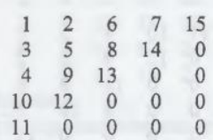

### Алгоритм решения

Создан класс Matrix с одним приватным полем. Поле - двумерный массив вещественных чисел. Затем идут 4 конструктора:
1) Конструктор с 2 параметрами целочисленного типа, в котором инициализируется матрица и заполняется с клавиатуры по столбцам снизу вверх.
2) Конструктор с 2 параметрами (целочисленного, логического типа), инициализирует квадратную матрицу. Логический параметр нужен для того, чтобы различать типы генерации квадратной матрицы (этот конструктор и 3). Заполнения массива вещественными числами рандомно при этом элементы лежавшие выше главной диагонали в диапазоне от - 4.5 до 45.675, а на диагонали и ниже от -100 до 100.
3) Конструктор с 1 целочисленным параметром - инициализирует квадратную матрицу. Заполнение элементов происходит последовательно возрастающими числами от 1, при этом обход матрицы выполняется по диагоналям, меняя направление движения для четных и нечетных индексов диагоналей.

### Тестирование
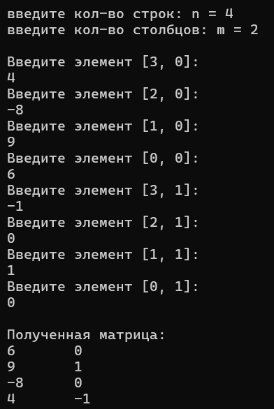
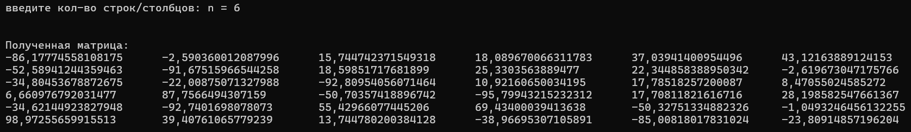
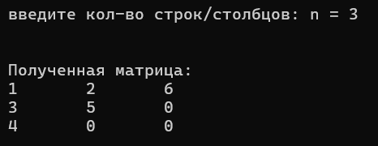

# Задание 2

## Задача 2

### Текст задачи

Найдите минимальный из повторяющихся элементов двумерного массива.

### Алгоритм решения

В ранее описанный класс Matrix были добавлены публичные свойства (строки и столбца) с целочисленным типом, в которых можем только получить данные. Также добавлен индексатор для обращения к матрице через квадратные скобки. И метод GetMinDuplicate вещественного типа, допускающий значение null. В методе копируются записи из матрицы в 1 ряд и сортруются от меньшего к большему и ищет первую повторяющуюся пару элементов подряд. Найденное число и будет минимальным повтором, если же повторов не будет, то возвратит null.

### Тестирование

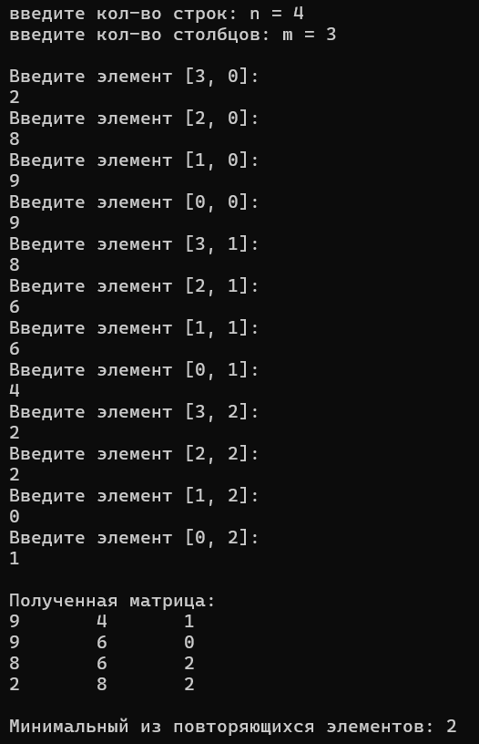
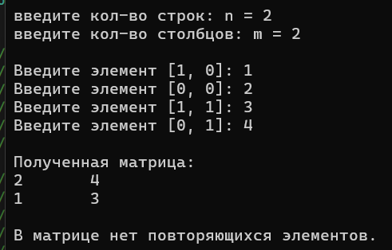

# Задание 3

## Задача 2

### Текст задачи

Вычислить: А+2*В-З*Ст

### Алгоритм решения

В ранее описанный класс Matrix также были добавлены перегруженные статические операторы для выполнения математических операций, переопределен метод ToString() и добавлен метод, транспонирующий матрицу:
- Операторы сложения (+) и вычитания (-) - принимают два объекта класса Matrix в качестве параметров и выполняют их поэлементное сложение или вычитание. Перед этим они проверяют размеры матриц, и если они не совпадают, то выдают ошибку (ArgumentException).
- Оператор умножения (*) - принимает два параметра (матрицу и целое число). Они перегружены в двух вариантах, чтобы можно было умножать как матрицу на число, так и число на матрицу, поэлементно увеличивая каждое значение.
- Метод Transpose() - не принимает параметров, а меняет строки и столбцы текущей матрицы местами, возвращая новый результат.
- Переопределенный метод ToString()

### Тестирование

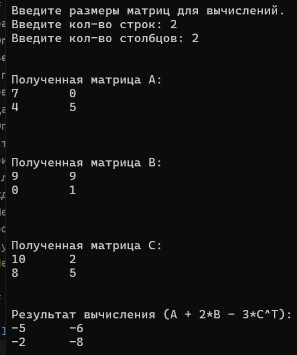
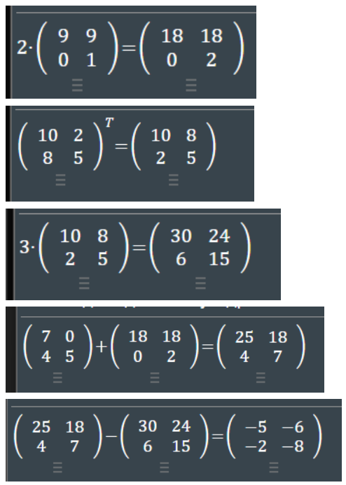

# Задание 4

## Задача 2

### Текст задачи

Вычислить произведение нечетных отрицательных компонент файла.

### Алгоритм решения
В статический класс FileTasks добавлены 2 метода:
1) Вспомогательный метод WriteRandomBinary. Он принимает путь к файлу, количество элементов и логический флаг isBinary. Если флаг равен true, метод генерирует случайные целые числа в диапазоне [-50; 50], переводит каждое число в 4-байтовый формат с помощью BitConverter.GetBytes и записывает итоговый байтовый массив на диск через File.WriteAllBytes. Если флаг равен false, метод записывает случайные числа в обычном текстовом виде через StreamWriter.
2) статический метод MulNegativeOdd - имеет вещественный тип, допускающий значение null. Он считывает все байты из бинарного файла через File.ReadAllBytes, делит размер массива на 4 для определения количества чисел и запускает цикл. Каждые 4 байта переводятся в целое число с помощью BitConverter.ToInt32 и проверяются на соответствие условиям: число должно быть меньше нуля и быть нечетным. Подходящие элементы перемножаются в переменную rez. Если в файле нашелся хотя бы один такой элемент, метод возвращает итоговое произведение, в противном случае возвращается null.

### Тестирование
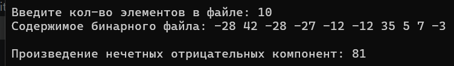
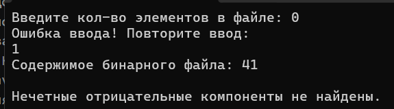

# Задание 6

## Задача 2

### Текст задачи

В файле найти сумму квадратов элементов.

### Алгоритм решения

В ранее описанный статический класс FileTasks добавлен публичный метод SumSquarEl с типом данных long, принимающий путь к текстовому файлу. С помощью метода File.ReadAllLines содержимое файла считывается в массив строк lines, где каждая строка соответствует одному числу. Для накопления результата создается переменная sum типа long со стартовым значением 0. В цикле программа проходит по всем строкам массива, преобразует каждую из них в целое число через int.Parse(lines[i]), возводит его в квадрат с явным приведением к типу (long) и прибавляет к переменной sum. После завершения цикла метод возвращает итоговую сумму квадратов всех элементов.

### Тестирование
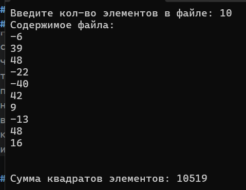
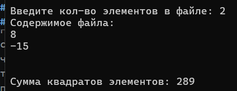

# Задание 7

## Задача 2

### Текст задачи

Вычислить произведение элементов.

### Алгоритм решения

В ранее описанный статический класс FileTasks добавлены методы :
1. Вспомогательный метод WriteRandomStruct - создает тестовый файл заданной размерности, генерируя случайные числа от -10 до 10 и объединяя их внутри каждой строки через пробел с помощью string.Join.
2. Статический метод MulEl - имеет тип long и вычисляет произведение элементов. Он считывает файл построчно через File.ReadAllLines и во вложенных циклах разбивает каждую строку на отдельные числа методом Split(). Элементы преобразуются через int.Parse(), явно приводятся к типу (long) и перемножаются в переменную mul со стартовым значением 1. Метод возвращает итоговое произведение всех чисел.

### Тестирование
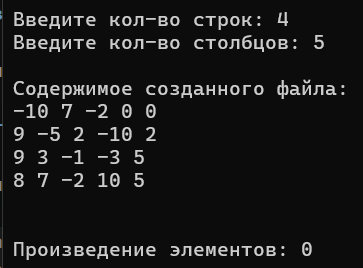
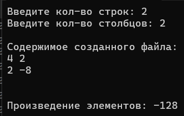

# Задание 8

## Задача 2

### Текст задачи

Переписать в другой файл строки, имеющие заданную длину m.

### Алгоритм решения
В ранее описанный статический класс FileTasks добавлен публичный метод ReWrite с типом данных int, принимающий пути к двум файлам и заданную длину строки m. С помощью File.ReadAllLines содержимое исходного файла считывается в массив строк allLines. В первом цикле программа считает количество строк с длиной, равной m. Затем создается новый массив строк line под это количество, и во втором цикле подходящие строки копируются в него. С помощью метода File.WriteAllLines отфильтрованные строки записываются в новый текстовый файл, а метод возвращает количество переписанных элементов.

### Тестирование
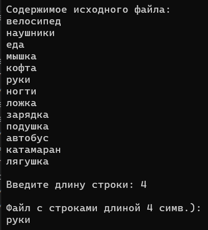
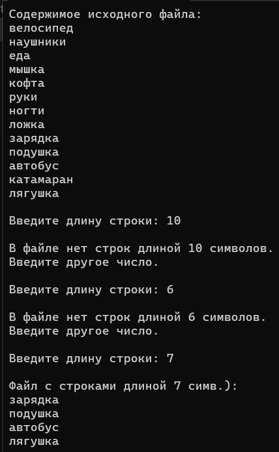