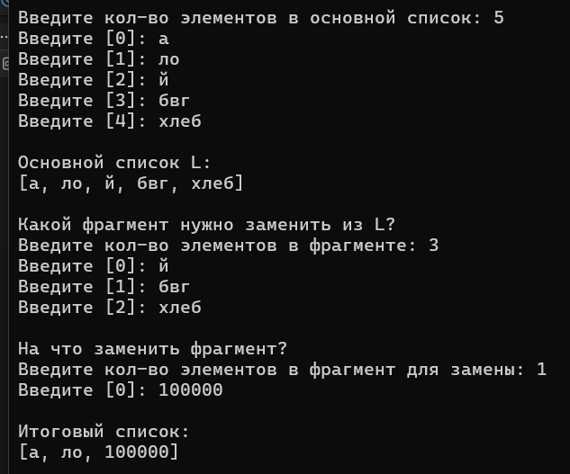
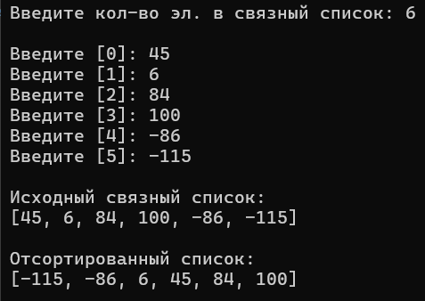
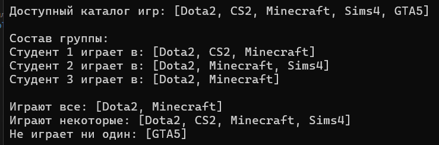
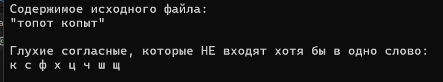
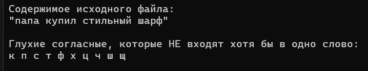
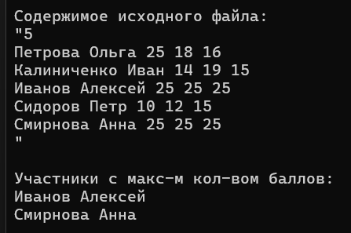
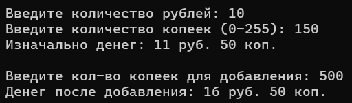
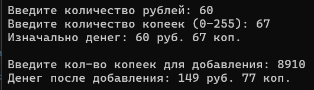
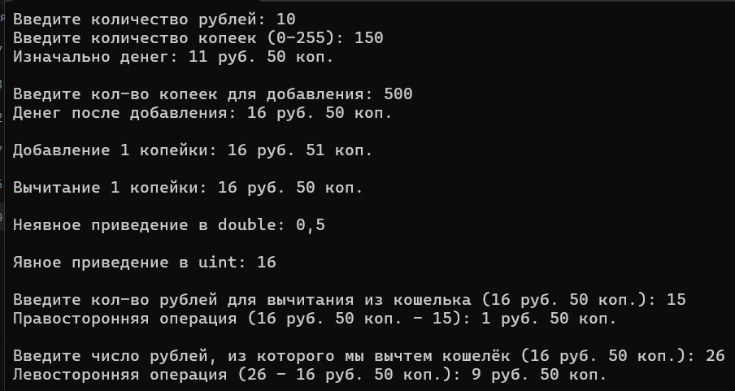

# Галловай Алёна ЛА2 Лабораторная №4 Вариант 2

# Задание 1

## Задача 2

### Текст задачи

Составить программу, которая в списке L заменяет первое вхождение списка L1 (если такое есть)
на список L2.

### Алгоритм решения

Создан публичный статический логический метод ReplaceList, принимающий три списка целых чисел: основной список List, искомый подсписок List1 и список для замены List2. Метод возвращает ложь, когда элементов в искомом списке нет или когда не нашлось нужной подстроки. Если же подстроку нашло, то элементы удаляются через RemoveRange и на их место с помщью InsertRange вставляются эл списка List2, а сам метод возвращает истину.

### Тестирование

# Задание 2

## Задача 2

### Текст задачи

Сортировать элементов списка по возрастанию.

### Алгоритм решения

Создан публичный статический метод SortLinkedList, принимающий связный список целых чисел list. Метод сразу завершает работу, если список пуст или содержит меньше двух элементов. Сортировка выполняется вставками: в цикле while самый первый элемент исходного списка последовательно извлекается и удаляется из него. При этом с помощью внутреннего цикла while находится правильная позиция в новом связном списке sortedList для сортировки. В конце работы метода исходный список, который к этому моменту уже пуст, просто заполняется упорядоченными элементами из sortedList.

### Тестирование

# Задание 3

## Задача 2

### Текст задачи

Есть перечень компьютерных игр. Студенты группы играют в какие-либо из этих игр. Известно
для каждого студента, в какие игры он играет. Определить:
* в какие игры из перечня играют все студенты группы;
* в какие игры из перечня играют некоторые студенты группы;
* в какие игры из перечня не играет ни один из студентов группы?

### Алгоритм решения

Создан публичный статический метод StudentGame, принимающий множество всех доступных игр allGames и список множеств group, содержащий игры каждого студента. Метод сразу завершает работу, если список студентов не создан или пуст. В ином случае создаются два множества playAll и playSome, инициализированные играми первого студента. Далее с помощью цикла for перебираются все остальные студенты группы: методом IntersectWith находится пересечение игр для заполнения playAll (играют все), а методом UnionWith - объединение игр для playSome (играют некоторые). Затем создается копия множества всех игр playNobody, из которой с помощью метода ExceptWith вычитаются игры, вошедшие в playSome. В конце работы метода полученные множества выводятся на экран в консоль.

### Тестирование

# Задание 4

## Задача 2

### Текст задачи

Файл содержит текст на русском языке. Напечатать в алфавитном порядке все глухие согласные
буквы, которые не входят хотя бы в одно слово.

### Алгоритм решения

Для решения задачи реализован вспомогательный приватный метод ExtractWords, который разбивает исходный текст на массив слов по знакам препинания, пробелам и тп, удаляя пустые элементы и приводя все слова к нижнему регистру. Основная логика реализована в публичном статическом методе PrintLetters, принимающим текст из файла. В начале метода создается множество, содержащее все глухие согласные буквы. Затем с помощью ExtractWords из текста извлекаются слова. Если слова отсутствуют, метод завершает работу. В ином случае создается множество lettersInAllWords на основе букв первого слова. Далее с помощью цикла for и встроенного метода пересечения IntersectWith находятся буквы, которые присутствуют во всех словах текста одновременно. После этого из общего множества глухих согласных методом ExceptWith вычитаются буквы, вошедшие во все слова, в результате чего остаются только те согласные, которые не входят хотя бы в одно слово. Для вывода результата в алфавитном порядке элементы переносятся в список, сортируются методом Sort и выводятся на экран.

### Тестирование

# Задание 5

## Задача 2

### Текст задачи

На городской олимпиаде по информатике участникам было предложено выполнить 3 задания,
каждое из которых оценивалось по 25-балльной шкале. Известно, что общее количество
участников первого тура олимпиады не превосходит 250 человек. На вход программы подаются
сведения о результатах олимпиады.В первой строке вводится количество участников N. Далее
следуют N строк, имеющих следующий формат:

**<Фамилия><Имя><Баллы>**

Здесь<Фамилия>– строка, состоящая не более чем из 20 символов;<Имя>– строка, состоящая не
более чем из 15 символов;<Баллы>– строка, содержащая три целых числа, разделенных
пробелом, соответствующих баллам, полученным участником за каждое задание первого тура.
При этом <Фамилия> и <Имя>, <Имя> и <Баллы> разделены одним пробелом. Примеры входных
строк:

**Петрова Ольга 25 18 16**

**Калиниченко Иван 14 19 15**

Напишите программу, которая будет выводить на экран фамилию и имя участника, набравшего
максимальное количество баллов. Если среди остальных участников есть ученики, набравшие
такое же количество баллов, то их фамилии и имена также следует вывести. При этом имена и
фамилии можно выводить в произвольном порядке

### Алгоритм решения

Для подготовки входных данных создан публичный статический метод CreateTestFile, который записывает в текстовый файл количество участников и сведения об их результатах. Считывание данных выполняется с помощью универсального метода ReadTextFile. Далее работа переходит в публичный статический метод PrintWinners, который принимает строковый параметр с содержимым файла. Метод сразу завершает работу, если текста нет. В ином случае текст разбивается на массив строк с удалением пустых элементов, если они есть. Из первой строки с помощью int.Parse извлекается количество участников, на основе которого создается словарь participants с заданной емкостью и парами «ключ — строка, значение — целое число». Далее с помощью цикла for перебираются строки участников, начиная со второй. Каждая строка разбивается по пробелам на массив элементов. Если в записи присутствует не менее пяти элементов, фамилия и имя объединяются в строку-ключ, а три оценки переводятся в целые числа и суммируются. Если такого ключа в словаре еще нет, запись добавляется в participants. В завершение с помощью двух циклов foreach выполняется поиск победителей: в первом цикле определяется максимальный набранный балл, а во втором на экран выводятся фамилии и имена всех участников, чей результат совпал с этим максимумом.

### Тестирование

# Задание 6

## Задача 2

### Текст задачи

Название класса - Money.

Поля - uint rubles, byte kopeks.

Методы:

Добавление произвольного количества
копеек (uint) к объекту типа Money.
Результат должен быть типа Money.

### Алгоритм решения

Создан класс Money с 2 приватными полями: _rubles (целое беззнаковое число для хранения рублей) и _kopeks (байт для хранения копеек). Далее описывается коструктор с 2 параметрами типа uint и byte, который инициализирует объект. Также описаны публичные свойства рубля и копейки. При этом в свойстве для копеек есть перевод в рубли если копеек 100 и более. Также описан публичный метод     AddKopeks для добавления произвольного количества копеек к объекту типа Money, который использует ранее описанную логику перевода.

### Тестирование

# Задание 7

## Задача 2

### Текст задачи

Название класса - Money.

Методы:

Унарные операции:

++ добавление копейки к объекту типа Money

-- вычитание копейки из объекта типа Money

Операции приведения типа:

uint (явная) – результатом является количество рублей (копейки
отбрасываются);

double(неявная) – результатом является копейки, переведенные в рубли,
целые рубли отбрасываются, результат < 1.

Бинарные операции:

+ Money m, беззнаковоецелое число (лево- и правосторонние операции).
Результат должен быть типа Money.

+ Money m, беззнаковоецелое число (лево- и правосторонние операции).
Результат должен быть типа Money.

### Алгоритм решения

В ранее описанный класс были добавленны перегруз унарных оперций с проверкой не уходить в минус при вычитании копейки. Также реализованы бинарные операции сложения и вычитания денежной суммы с беззнаковым целым числом (рублями) для правостороннего и левостороннего случаев. Также описаны операции явного приведения объекта к типу uint для получения рублей и неявного приведения к типу double для перевода копеек в рубли. И перегрузка метода ToString.

### Тестирование

