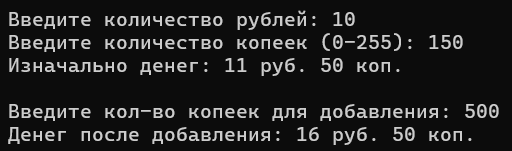
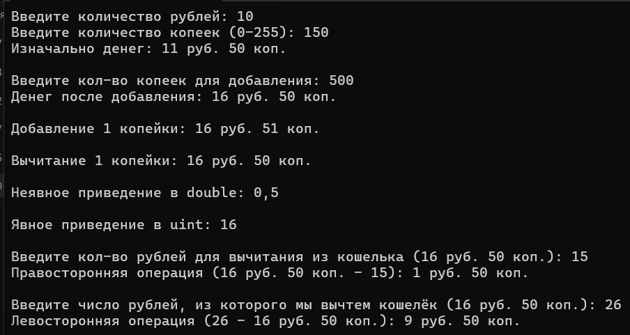

# Галловай Алёна ЛА2 Лабораторная №4 Вариант 2

# Задание 1

## Задача 2

### Текст задачи

Составить программу, которая в списке L заменяет первое вхождение списка L1 (если такое есть)
на список L2.

### Алгоритм решения

### Тестирование

# Задание 2

## Задача 2

### Текст задачи

Сортировать элементов списка по возрастанию.

### Алгоритм решения

### Тестирование

# Задание 3

## Задача 2

### Текст задачи

Есть перечень компьютерных игр. Студенты группы играют в какие-либо из этих игр. Известно
для каждого студента, в какие игры он играет. Определить:
* в какие игры из перечня играют все студенты группы;
* в какие игры из перечня играют некоторые студенты группы;
* в какие игры из перечня не играет ни один из студентов группы?

### Алгоритм решения

### Тестирование

# Задание 4

## Задача 2

### Текст задачи

Файл содержит текст на русском языке. Напечатать в алфавитном порядке все глухие согласные
буквы, которые не входят хотя бы в одно слово.

### Алгоритм решения

### Тестирование

# Задание 5

## Задача 2

### Текст задачи

На городской олимпиаде по информатике участникам было предложено выполнить 3 задания,
каждое из которых оценивалось по 25-балльной шкале. Известно, что общее количество
участников первого тура олимпиады не превосходит 250 человек. На вход программы подаются
сведения о результатах олимпиады.В первой строке вводится количество участников N. Далее
следуют N строк, имеющих следующий формат:
**<Фамилия><Имя><Баллы>**
Здесь<Фамилия>– строка, состоящая не более чем из 20 символов;<Имя>– строка, состоящая не
более чем из 15 символов;<Баллы>– строка, содержащая три целых числа, разделенных
пробелом, соответствующих баллам, полученным участником за каждое задание первого тура.
При этом <Фамилия> и <Имя>, <Имя> и <Баллы> разделены одним пробелом. Примеры входных
строк:
**Петрова Ольга 25 18 16**
**Калиниченко Иван 14 19 15**
Напишите программу, которая будет выводить на экран фамилию и имя участника, набравшего
максимальное количество баллов. Если среди остальных участников есть ученики, набравшие
такое же количество баллов, то их фамилии и имена также следует вывести. При этом имена и
фамилии можно выводить в произвольном порядке

### Алгоритм решения

### Тестирование

# Задание 6

## Задача 2

### Текст задачи

Название класса - Money.
Поля - uint rubles, byte kopeks .
Методы:
Добавление произвольного количества
копеек (uint) к объекту типа Money.
Результат должен быть типа Money.

### Алгоритм решения

### Тестирование

# Задание 7

## Задача 2

### Текст задачи

Название класса - Money.
Методы:
Унарные операции:
++ добавление копейки к объекту типа Money
-- вычитание копейки из объекта типа Money
Операции приведения типа:
uint (явная) – результатом является количество рублей (копейки
отбрасываются);
double(неявная) – результатом является копейки, переведенные в рубли,
целые рубли отбрасываются, результат <1.
Бинарные операции:
+ Money m, беззнаковоецелое число (лево- и правосторонние операции).
Результат должен быть типа Money.
– Money m, беззнаковоецелое число (лево- и правосторонние операции).
Результат должен быть типа Money.

### Алгоритм решения

### Тестирование

