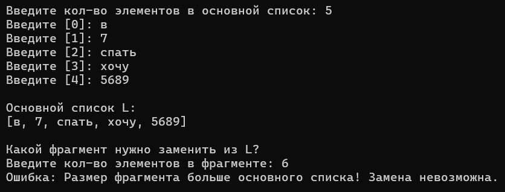
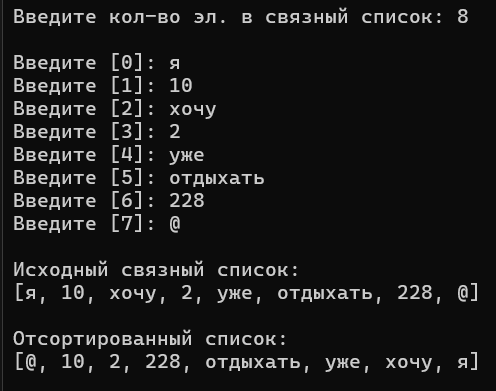
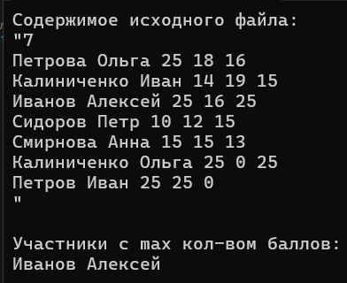
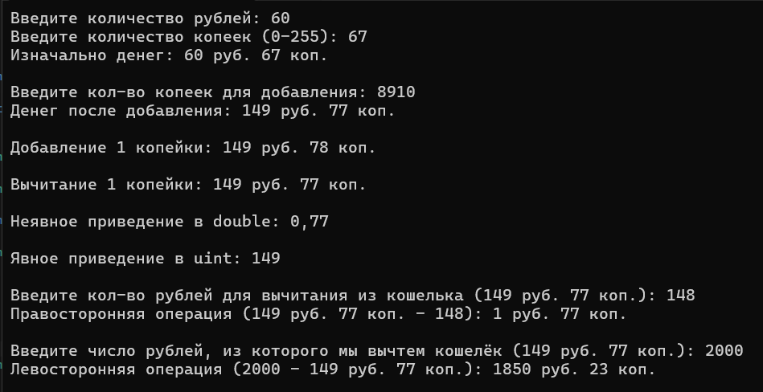

# Галловай Алёна ЛА2 Лабораторная №4 Вариант 2

# Задание 1

## Задача 2

### Текст задачи

Составить программу, которая в списке L заменяет первое вхождение списка L1 (если такое есть)
на список L2.

### Алгоритм решения

Создан публичный статический логический метод ReplaceList, принимающий три списка целых чисел: основной список List, искомый подсписок List1 и список для замены List2. Метод возвращает ложь, когда элементов в искомом списке нет или когда не нашлось нужной подстроки. Если же подстроку нашло, то элементы удаляются через RemoveRange и на их место с помщью InsertRange вставляются эл списка List2, а сам метод возвращает истину.

### Тестирование

# Задание 2

## Задача 2

### Текст задачи

Сортировать элементов списка по возрастанию.

### Алгоритм решения

Создан публичный статический метод SortLinkedList, принимающий связный список целых чисел list. Метод сразу завершает работу, если список пуст или содержит меньше двух элементов. Сортировка выполняется вставками: каждый элемент исходного списка последовательно переносится в новый связный список sortedList, при этом с помощью цикла while находится правильная позиция для сохранения упорядоченности. В конце работы метода исходный список очищается и заполняется уже отсортированными элементами.

### Тестирование

# Задание 3

## Задача 2

### Текст задачи

Есть перечень компьютерных игр. Студенты группы играют в какие-либо из этих игр. Известно
для каждого студента, в какие игры он играет. Определить:
* в какие игры из перечня играют все студенты группы;
* в какие игры из перечня играют некоторые студенты группы;
* в какие игры из перечня не играет ни один из студентов группы?

### Алгоритм решения

### Тестирование

# Задание 4

## Задача 2

### Текст задачи

Файл содержит текст на русском языке. Напечатать в алфавитном порядке все глухие согласные
буквы, которые не входят хотя бы в одно слово.

### Алгоритм решения

### Тестирование

# Задание 5

## Задача 2

### Текст задачи

На городской олимпиаде по информатике участникам было предложено выполнить 3 задания,
каждое из которых оценивалось по 25-балльной шкале. Известно, что общее количество
участников первого тура олимпиады не превосходит 250 человек. На вход программы подаются
сведения о результатах олимпиады.В первой строке вводится количество участников N. Далее
следуют N строк, имеющих следующий формат:

**<Фамилия><Имя><Баллы>**

Здесь<Фамилия>– строка, состоящая не более чем из 20 символов;<Имя>– строка, состоящая не
более чем из 15 символов;<Баллы>– строка, содержащая три целых числа, разделенных
пробелом, соответствующих баллам, полученным участником за каждое задание первого тура.
При этом <Фамилия> и <Имя>, <Имя> и <Баллы> разделены одним пробелом. Примеры входных
строк:

**Петрова Ольга 25 18 16**
**Калиниченко Иван 14 19 15**

Напишите программу, которая будет выводить на экран фамилию и имя участника, набравшего
максимальное количество баллов. Если среди остальных участников есть ученики, набравшие
такое же количество баллов, то их фамилии и имена также следует вывести. При этом имена и
фамилии можно выводить в произвольном порядке

### Алгоритм решения

### Тестирование

# Задание 6

## Задача 2

### Текст задачи

Название класса - Money.

Поля - uint rubles, byte kopeks.

Методы:

Добавление произвольного количества
копеек (uint) к объекту типа Money.
Результат должен быть типа Money.

### Алгоритм решения

Создан класс Money с 2 приватными полями: _rubles (целое беззнаковое число для хранения рублей) и _kopeks (байт для хранения копеек). Далее описывается коструктор с 2 параметрами типа uint и byte, который инициализирует объект. Также описаны публичные свойства рубля и копейки. При этом в свойстве для копеек есть перевод в рубли если копеек больше 100. Также описан публичный метод     AddKopeks для добавления произвольного количества копеек к объекту типа Money, который использует ранее описанную логику перевода.

### Тестирование

# Задание 7

## Задача 2

### Текст задачи

Название класса - Money.

Методы:

Унарные операции:

++ добавление копейки к объекту типа Money

-- вычитание копейки из объекта типа Money

Операции приведения типа:

uint (явная) – результатом является количество рублей (копейки
отбрасываются);

double(неявная) – результатом является копейки, переведенные в рубли,
целые рубли отбрасываются, результат < 1.

Бинарные операции:

+ Money m, беззнаковоецелое число (лево- и правосторонние операции).
Результат должен быть типа Money.

– Money m, беззнаковоецелое число (лево- и правосторонние операции).
Результат должен быть типа Money.

### Алгоритм решения

В ранее описанный класс были добавленны перегруз унарных оперций с проверкой не уходить в минус при вычитании копейки. Также реализованы бинарные операции сложения и вычитания денежной суммы с беззнаковым целым числом (рублями) для правостороннего и левостороннего случаев. Также описаны операции явного приведения объекта к типу uint для получения рублей и неявного приведения к типу double для перевода копеек в рубли. И перегрузка метода ToString.

### Тестирование

