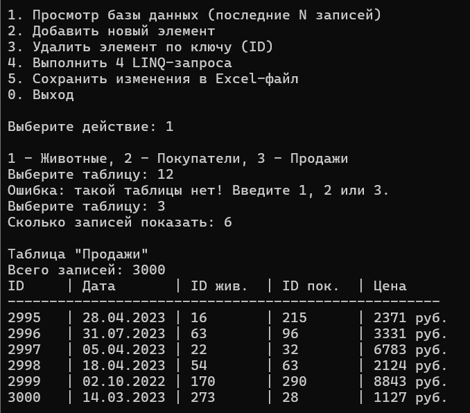
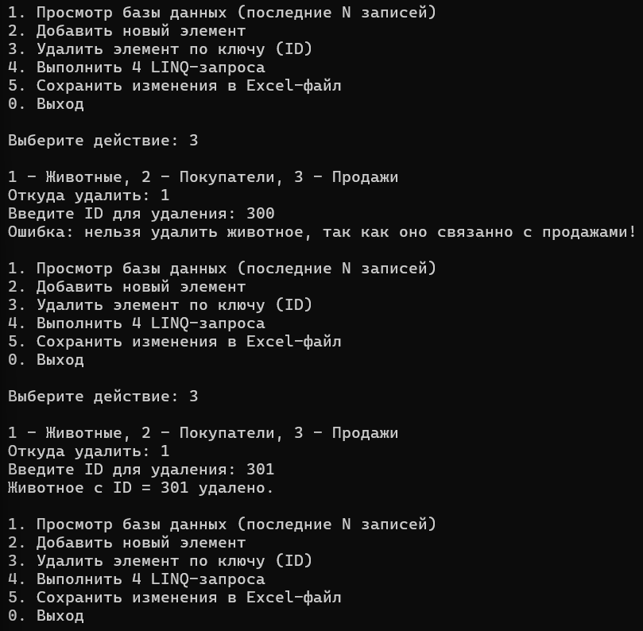
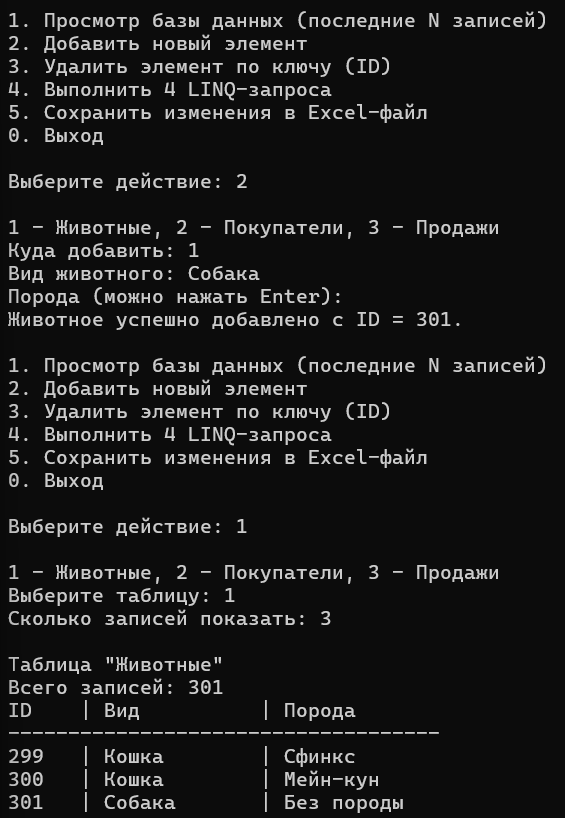
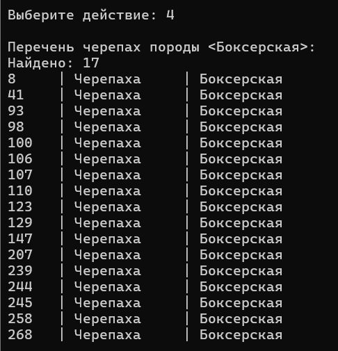
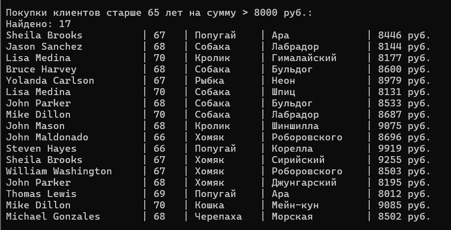
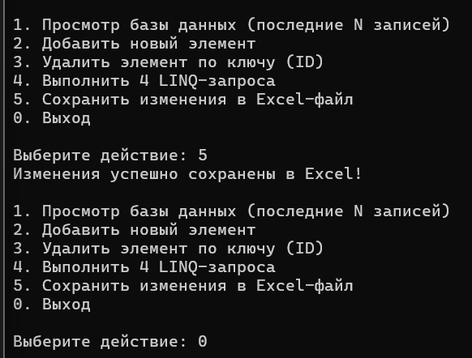

# Галловай Алёна ЛА2 Лабораторная №5 Вариант 2

# Задание 1

### Текст задачи
Проектирование классов и чтение базы данных из Excel-файла

### Алгоритм решения

Для работы с Excel-файлами в проект через NuGet установлены библиотеки ExcelDataReader и ExcelDataReader.DataSet (для чтения исходного .xls-файла) и ClosedXML (для сохранения изменений в .xlsx).

Для представления записей из таблиц созданы три внутренних класса:
* **Класс `Animals` (Животные):** • содержит 3 приватных поля (идентификатор, вид и порода), соответствующие им публичные свойства с проверкой корректности данных, конструктор с 3 параметрами и переопределённый метод ToString() для табличного вывода.

* **Класс `Buyers` (Покупатели):** • содержит 4 приватных поля (идентификатор, имя, возраст и адрес), публичные свойства с проверкой на пустоту и совершеннолетие (>= 18), конструктор с 4 параметрами и переопределённый метод ToString().

* **Класс `Sales` (Продажи):** содержит 5 приватных полей (идентификатор сделки, ключи животного и покупателя, дата и цена), публичные свойства с проверками корректности значений и даты, конструктор с 5 параметрами и переопределённый метод ToString().

Для управления базой данных создан класс Database, содержащий три приватных списка (_animals, _buyers, _sales) и конструктор без параметров для их инициализации.
Чтение данных реализовано в публичном методе ReadDatabase, принимающем путь к файлу. В начале метода регистрируется кодировка для работы с кириллицей и очищаются все три списка. Далее открывается файловый поток и с помощью ExcelDataReader книга преобразуется в набор таблиц DataSet. Выполняется проверка наличия всех трёх нужных листов («Продажи», «Покупатели», «Животные»): если файл пуст или какой-то лист отсутствует, метод выводит сообщение об ошибке и завершает работу. В ином случае программа последовательно проходит по каждому листу в цикле for (начиная со второй строки, чтобы пропустить заголовки), приводит значения ячеек к нужным типам (с переводом дат из числового формата OADate), создаёт объекты соответствующих классов (Sales, Buyers, Animals) и добавляет их в списки.

# Задание 2

### Текст задачи

Просмотр базы данных

### Алгоритм решения
В классе Database создан публичный метод ViewData, принимающий номер таблицы и количество записей для вывода. С помощью оператора switch в зависимости от выбранного номера выводится название таблицы, общее количество записей и форматированная шапка столбцов. Затем с помощью LINQ-метода .TakeLast() из соответствующего списка выбираются последние n элементов и построчно выводятся на экран в цикле foreach с использованием переопределённого метода ToString().

### Тестирование

# Задание 3

### Текст задачи
 
Удаление элементов (по ключу)

### Алгоритм решения

Для удаления записей в классе Database реализованы публичные методы DeleteAnimal, DeleteBuyer и DeleteSale, принимающие целочисленный идентификатор id и возвращающие логическое значение результата операции. В каждом методе с помощью .FirstOrDefault() выполняется поиск записи с указанным ключом. При удалении животного или покупателя с помощью .Any() предварительно проверяется, связан ли этот ключ с таблицей продаж _sales: если связанные продажи найдены, удаление запрещается; в ином случае элемент удаляется из списка методом .Remove().

### Тестирование

# Задание 4

### Текст задачи

Добавление элементов

### Алгоритм решения

Добавление новых записей реализовано в классе Database с помощью трёх перегруженных публичных методов Add, принимающих поля соответствующей таблицы. Новый уникальный ключ Id подбирается автоматически: программа находит самый большой номер в списке через .Max() и прибавляет к нему 1. При добавлении продажи дополнительно с помощью .Any() проверяется существование переданных ключей животного и покупателя в соответствующих списках, после чего создаётся новый объект (с проверкой корректности данных в конструкторе) и добавляется в список.

### Тестирование

# Задание 5

## Задача 1

### Текст задачи
Получить перечень всех черепах породы «Боксерская» (1 таблица, перечень).

### Алгоритм решения
В классе `Database` создан метод `Query1`, возвращающий список животных `List<Animals>`. С помощью LINQ-запроса программа просматривает список `_animals` и отбирает записи с видом `"Черепаха"` и породой `"Боксерская"`. Результат переводится в список через `.ToList()` и выводится в консоль методом `PrintList<T>`.

### Тестирование

## Задача 2

### Текст задачи
Определить, на какую сумму купили кошек породы «Сфинкс» в январе 2023 года (2 таблицы, одно значение).

### Алгоритм решения
В классе `Database` создан метод `Query2`, возвращающий целое число. В LINQ-запросе списки `_sales` и `_animals` соединяются через `join` по ключу `AnimalId`, отбираются кошки породы `"Сфинкс"`, проданные в январе (`Month == 1`) `2023` года, а их цены суммируются через `.Sum()`.

### Тестирование

## Задача 3

### Текст задачи
Вывести перечень всех покупок (имя покупателя, его возраст, вид и порода животного, цена), совершённых покупателями старше 65 лет на сумму более 8000 рублей (3 таблицы, перечень).

### Алгоритм решения
В классе `Database` создан метод `Query3`, возвращающий список строк `List<string>`. В LINQ-запросе соединяются все три списка (`_sales`, `_buyers`, `_animals`) по ключам `BuyerId` и `AnimalId`, отбираются клиенты старше `65` лет с покупками дороже `8000` рублей, а нужные поля объединяются в отформатированную строку и возвращаются через `.ToList()`.

### Тестирование

## Задача 4

### Текст задачи
Посчитать количество проданных хомяков покупателям из Москвы (3 таблицы, одно значение).

### Алгоритм решения
В классе `Database` создан метод `Query4`, возвращающий целое число. В LINQ-запросе соединяются все три списка, оставляются продажи животных вида `"Хомяк"` покупателям из города `"Москва"`, после чего их количество подсчитывается через `.Count()`.

### Тестирование

# Задание 6

### Текст задачи
Сохранение изменений в excel файле

### Алгоритм решения
В классе `Database` создан публичный метод `SaveDatabase`, принимающий путь для сохранения файла. С помощью библиотеки `ClosedXML` создаётся новая книга `XLWorkbook`, куда добавляются листы «Продажи», «Покупатели» и «Животные». На каждый лист начиная с первой ячейки (`A1`) через `.InsertTable()` выгружается соответствующий список из памяти, после чего книга сохраняется на диск методом `SaveAs()`.

### Тестирование

